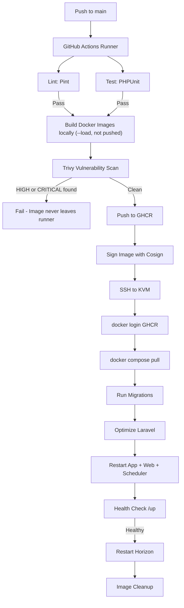

# KVM Docker Hardening & CI/CD Deployment Plan

## 1. Summary

This plan outlines the security hardening policies and automated CI/CD pipeline for deploying **ScanMySocial** on Hostinger KVM. It addresses securing the host operating system, securing Docker containers (non-root execution, privilege reduction, resource limits), and implementing a secure, automated deployment workflow using GitHub Actions and GitHub Container Registry (GHCR).

> **Golden Rule:** Never build or compile application artifacts on the production VPS. The VPS should only pull prebuilt, tested, and scanned images from GHCR, run database migrations, perform health checks, and start containers. All compilation and image creation happens inside GitHub Actions, ensuring every deployment uses the exact image that passed CI.

---

## 2. Host OS & SSH Hardening

Securing the KVM host is the first line of defense.

### SSH Access Hardening

Disable password-based SSH login. Only authorized SSH public keys may connect.

In `/etc/ssh/sshd_config` on the KVM:

```text
PasswordAuthentication no
PubkeyAuthentication yes
PermitRootLogin no
```

Restart SSH after changes:

```bash
sudo systemctl restart ssh
```

> **Important:** Verify the `deploy` user has working `sudo` access and a key in `~/.ssh/authorized_keys` before disabling root login. Use Hostinger's browser-based VNC/serial console as a fallback if you lose SSH access.

### Intrusion Prevention

Install and enable `fail2ban` to automatically ban IPs with suspicious SSH login failures:

```bash
sudo apt install -y fail2ban
sudo systemctl enable fail2ban
sudo systemctl start fail2ban
```

Verify status:

```bash
sudo fail2ban-client status sshd
```

### Automated Security Updates

Enable Ubuntu's `unattended-upgrades` to automatically install security patches:

```bash
sudo apt install -y unattended-upgrades
sudo dpkg-reconfigure --priority=low unattended-upgrades
```

---

## 3. Firewall & Docker UFW Bypass Hardening

### The Docker UFW Bypass Vulnerability

By default, Docker manipulates `iptables` directly to expose container ports. This bypasses system-level firewalls like `ufw` completely. A service like MySQL with a `ports: ["3306:3306"]` mapping would be reachable from the public internet even when UFW is active and blocking port 3306.

### Mitigation

1. **Bind container ports to localhost only.** The `web` service is the only container that needs a host port mapping, and it must be bound to `127.0.0.1`:

   ```yaml
   ports:
     - "127.0.0.1:8080:80"
   ```

   Caddy on the host proxies to `127.0.0.1:8080`. This port is never reachable from the internet.

2. **No port mappings for internal services.** `mysql` and `redis` must never define `ports`. They communicate only through the internal Docker bridge network (`scanmysocial`).

3. **Host-Level UFW Rules:**

   ```bash
   sudo ufw default deny incoming
   sudo ufw default allow outgoing
   sudo ufw allow 22/tcp
   sudo ufw allow 80/tcp
   sudo ufw allow 443/tcp
   sudo ufw enable
   sudo ufw status verbose
   ```

---

## 4. Docker Container Hardening

Apply the principle of least privilege to every container.

### A. Non-Root Execution

#### Laravel App Container (PHP-FPM)

Switch the execution user to `www-data` in the `Dockerfile`:

```dockerfile
# Set permissions for www-data
RUN chown -R www-data:www-data /var/www/html

USER www-data
```

Update `docker/entrypoint.sh` to not rely on root commands:

```bash
#!/usr/bin/env sh
set -e

mkdir -p bootstrap/cache storage/framework/views storage/logs

exec "$@"
```

#### Nginx Web Container

Nginx binds to port `80` internally. Since we map to `8080` on the host, change Nginx to listen on `8080` so the process can run as the unprivileged `nginx` user.

Update `docker/nginx/default.conf`:

```nginx
server {
    listen 8080;
    server_name _;
    root /var/www/html/public;
    ...
}
```

Update the `web` stage in `Dockerfile`:

```dockerfile
FROM nginx:1.27.4-alpine AS web
WORKDIR /var/www/html
COPY docker/nginx/default.conf /etc/nginx/conf.d/default.conf
COPY --from=app /var/www/html/public ./public
USER nginx
```

### B. Privilege Escalation Prevention

Apply `no-new-privileges` to **every** service in `docker-compose.yml`. This prevents any process inside a container from gaining additional kernel privileges, even if a SUID binary or exploit is present.

```yaml
security_opt:
  - no-new-privileges:true
```

This must be present on `app`, `web`, `horizon`, `scheduler`, `mysql`, and `redis`.

### C. Read-Only Root Filesystems

Run container filesystems as read-only to prevent malicious scripts or web shells from being written. Mount writable paths as `tmpfs` (in-memory) or named volumes.

```yaml
app:
  image: ghcr.io/gyaanesh/viralyzer-app:latest
  read_only: true
  tmpfs:
    - /tmp
    - /var/run
  volumes:
    - app_storage:/var/www/html/storage
    - app_bootstrap_cache:/var/www/html/bootstrap/cache
```

> **Caveat:** Before enabling `read_only: true` in production, explicitly verify that every writable path the application needs — including `storage/logs`, `storage/framework/sessions`, `storage/framework/views`, `storage/framework/cache`, `bootstrap/cache`, and any temporary upload paths — is mounted as either a named volume or a `tmpfs` entry. Missing a single writable path will cause the application to fail unexpectedly at runtime, often with cryptic permission errors.

### D. Capability Dropping

Drop all Linux kernel capabilities from every container:

```yaml
cap_drop:
  - ALL
```

PHP-FPM and Nginx running as non-root require no additional capabilities.

### E. Restart Policies

All long-running services must declare a `restart` policy. Without it, a crashed container stays down until someone manually intervenes.

```yaml
# Apply to: app, web, horizon, scheduler, mysql, redis
restart: unless-stopped
```

`unless-stopped` restarts a container automatically after any crash or after the Docker daemon itself restarts (e.g., after a VPS reboot), and only stays stopped when you explicitly `docker compose stop`.

### F. Init Process

Add `init: true` to all services. This gives every container a proper PID 1 init process (Docker's built-in `tini`) which correctly forwards signals and reaps zombie child processes. Without it, PHP-FPM workers or shell scripts spawned inside containers can become zombie processes over time.

```yaml
# Apply to: app, web, horizon, scheduler
init: true
```

### G. Resource Limits

> **Important — Docker Compose vs Docker Swarm:** The `deploy.resources` block is a **Docker Swarm feature** and is **not enforced** by plain `docker compose up`. If you use `docker compose` without Swarm, these limits are silently ignored. The options below are the correct alternatives for standalone Compose deployments.

For standard Docker Compose (Hostinger VPS without Swarm), use the v2-compatible `mem_limit` and `cpus` keys directly on the service:

```yaml
services:
  app:
    mem_limit: 1g
    cpus: '1.5'

  horizon:
    mem_limit: 1.5g
    cpus: '0.75'

  scheduler:
    mem_limit: 256m
    cpus: '0.25'

  mysql:
    mem_limit: 512m
    cpus: '0.5'

  redis:
    mem_limit: 128m
    cpus: '0.25'
```

These keys are enforced by Docker Engine directly via cgroups and apply to regular Compose deployments.

### H. Automatic Update Tools (Watchtower)

Automatic image update tools such as **Watchtower** are intentionally not used. Deployments are performed only through the CI/CD pipeline to ensure every release is built, tested, scanned, and traceable before it reaches production. Watchtower-style auto-pulls would bypass the scanning and quality gates entirely.

### I. Health Checks

Every production service must have a health check so Docker knows when a container is genuinely healthy and can restart it if it degrades.

```yaml
# Laravel App (PHP-FPM)
app:
  healthcheck:
    test: ["CMD", "php", "-v"]
    interval: 30s
    timeout: 5s
    retries: 3
    start_period: 30s

# Nginx Web (Laravel /up endpoint)
web:
  healthcheck:
    test: ["CMD", "curl", "-f", "http://localhost:8080/up"]
    interval: 30s
    timeout: 5s
    retries: 3
    start_period: 15s

# Horizon
horizon:
  healthcheck:
    test: ["CMD", "php", "artisan", "horizon:status"]
    interval: 60s
    timeout: 10s
    retries: 3
    start_period: 30s
```

Laravel 12's `/up` endpoint returns a `200 OK` when the application is healthy. Use this for any HTTP-capable container health check.

### J. Secure Internal Service Credentials

**Redis Password Authentication:** Redis must not run without a password. Configure `REDIS_PASSWORD` in `.env.docker`. Pass it to the Redis command at startup:

```yaml
redis:
  image: redis:7.4-alpine
  command: redis-server --requirepass "${REDIS_PASSWORD}" --appendonly yes
```

### K. Pin Image Versions

Never use floating tags in production. Floating tags like `redis:7-alpine` or `nginx:latest` can silently introduce breaking changes or security vulnerabilities on the next pull.

Pin all base images to exact patch versions:

| Service | Floating Tag | Pinned Tag (example) |
| --- | --- | --- |
| Node (build) | `node:20-bookworm-slim` | `node:20.19.3-bookworm-slim` |
| PHP-FPM | `php:8.4-fpm-bookworm` | `php:8.4.10-fpm-bookworm` |
| Nginx | `nginx:1.27-alpine` | `nginx:1.27.4-alpine` |
| MySQL | `mysql:8.4` | `mysql:8.4.5` |
| Redis | `redis:7-alpine` | `redis:7.4-alpine` |

Update pinned versions deliberately when upgrading, reviewing the changelog for security and breaking changes before doing so.

---

## 5. CI/CD Pipeline (GitHub Actions & GHCR)

Code is built, linted, and tested on GitHub Actions runners, packaged into Docker images, scanned for vulnerabilities, pushed to GHCR, and then deployed to KVM over a secure SSH connection.



### Stage 1: Quality Assurance

```yaml
- name: Lint with Pint
  run: vendor/bin/pint --test

- name: Run Tests
  run: php artisan test --compact
  env:
    DB_CONNECTION: sqlite
    DB_DATABASE: ":memory:"
```

### Stage 2: Build Locally (Do Not Push Yet)

Build the image and load it into the runner's local Docker daemon using `--load`. The image is not pushed to GHCR at this stage — it must be scanned first.

```yaml
- name: Set up Docker Buildx
  uses: docker/setup-buildx-action@v3

- name: Build app image locally for scanning
  uses: docker/build-push-action@v5
  with:
    context: .
    target: app
    # load: true loads into local Docker daemon; push: false keeps it off the registry
    load: true
    push: false
    tags: ghcr.io/gyaanesh/viralyzer-app:${{ github.sha }}
    cache-from: type=gha
    cache-to: type=gha,mode=max
    build-args: |
      VITE_PUSHER_APP_KEY=${{ secrets.VITE_PUSHER_APP_KEY }}
      VITE_PUSHER_APP_CLUSTER=${{ secrets.VITE_PUSHER_APP_CLUSTER }}
      VITE_RAZORPAY_KEY_ID=${{ secrets.VITE_RAZORPAY_KEY_ID }}
```

### Stage 3: Vulnerability Scanning (Trivy)

Scan the locally loaded image. Because `push: false` was used in Stage 2, a vulnerable image never reaches the registry — it is blocked here on the runner and discarded.

Pin the Trivy action to a specific tagged release rather than `@master`. Unpinned actions can change behavior without notice:

```yaml
- name: Scan image with Trivy
  uses: aquasecurity/trivy-action@0.28.0
  with:
    image-ref: ghcr.io/gyaanesh/viralyzer-app:${{ github.sha }}
    format: table
    exit-code: '1'
    severity: 'HIGH,CRITICAL'
    ignore-unfixed: true
```

If the scan fails, the pipeline exits immediately. The image is never pushed to GHCR or deployed.

### Stage 4: Push to GHCR (After Clean Scan)

Only after the Trivy scan passes, push the image to GHCR with all tags:

```yaml
- name: Log in to GHCR
  uses: docker/login-action@v3
  with:
    registry: ghcr.io
    username: ${{ github.actor }}
    password: ${{ secrets.GITHUB_TOKEN }}

- name: Push verified image to GHCR
  uses: docker/build-push-action@v5
  with:
    context: .
    target: app
    push: true
    tags: |
      ghcr.io/gyaanesh/viralyzer-app:latest
      ghcr.io/gyaanesh/viralyzer-app:main
      ghcr.io/gyaanesh/viralyzer-app:${{ github.sha }}
    cache-from: type=gha
    build-args: |
      VITE_PUSHER_APP_KEY=${{ secrets.VITE_PUSHER_APP_KEY }}
      VITE_PUSHER_APP_CLUSTER=${{ secrets.VITE_PUSHER_APP_CLUSTER }}
      VITE_RAZORPAY_KEY_ID=${{ secrets.VITE_RAZORPAY_KEY_ID }}
```

### Stage 5: Image Signing (Cosign)

After pushing, cryptographically sign the image using [Cosign](https://docs.sigstore.dev/cosign/overview/) (part of the Sigstore project). Signed images provide supply-chain integrity — verifying that the image in GHCR was produced by your CI pipeline and not tampered with.

```yaml
- name: Install Cosign
  uses: sigstore/cosign-installer@v3.5.0

- name: Sign image with Cosign (keyless via OIDC)
  run: |
    cosign sign --yes \
      ghcr.io/gyaanesh/viralyzer-app:${{ github.sha }}
  env:
    COSIGN_EXPERIMENTAL: 1
```

Keyless signing uses GitHub Actions' built-in OIDC identity — no separate private key is required. The signature is publicly verifiable on the Sigstore transparency log.

To verify a signed image before deployment:

```bash
cosign verify \
  --certificate-identity-regexp="https://github.com/gyaanesh/Viralyzer" \
  --certificate-oidc-issuer="https://token.actions.githubusercontent.com" \
  ghcr.io/gyaanesh/viralyzer-app:abc1234
```

### Stage 4: Deploy Over SSH

```yaml
- name: Deploy to KVM
  uses: appleboy/ssh-action@v1.0.3
  with:
    host: ${{ secrets.KVM_HOST }}
    username: ${{ secrets.KVM_USER }}
    key: ${{ secrets.KVM_SSH_KEY }}
    script: |
      cd /var/www/scanmysocial

      # 1. Authenticate with GHCR
      echo "${{ secrets.GHCR_TOKEN }}" | docker login ghcr.io -u ${{ github.actor }} --password-stdin

      # 2. Pull latest images
      docker compose --env-file .env.docker pull

      # 3. Run migrations
      docker compose --env-file .env.docker run --rm app php artisan migrate --force

      # 4. Optimize Laravel
      docker compose --env-file .env.docker run --rm app php artisan optimize

      # 5. Restart App, Web, and Scheduler (not Horizon yet)
      docker compose --env-file .env.docker up -d --no-deps app web scheduler

      # 6. Health check
      sleep 10
      curl --fail http://127.0.0.1:8080/up || (echo "Health check failed" && exit 1)

      # 7. Gracefully restart Horizon
      docker compose --env-file .env.docker exec -T horizon php artisan horizon:terminate
      docker compose --env-file .env.docker up -d --no-deps horizon

      # 8. Clean up dangling images
      docker image prune -f
```

---

## 6. Image Tagging Strategy

Use a layered tagging strategy that supports both rollbacks and traceability:

| Tag | Purpose |
| --- | --- |
| `latest` | Always points to the most recent successful build |
| `main` | Tracks the `main` branch HEAD |
| `v1.3.0`, `v1.3.1` | Semantic version tags — set manually for planned releases |
| `abc1234` (commit SHA) | Immutable reference — used for rollbacks to a specific commit |

**Always roll back to an immutable commit SHA, not to `latest` or `main`.** Mutable tags like `latest` can point to a different image than the one you intend to restore. The commit SHA is the only tag guaranteed to reference exactly one specific build.

```bash
# On the KVM — target the exact commit SHA
export APP_TAG=abc1234

# Pull the specific SHA image
docker pull ghcr.io/gyaanesh/viralyzer-app:${APP_TAG}

# Update the image reference and restart
docker compose --env-file .env.docker up -d --no-deps app web horizon scheduler
```

---

## 7. GitHub Repository Secrets

Configure all of the following secrets in **GitHub → Settings → Secrets and variables → Actions**:

| Secret | Purpose |
| --- | --- |
| `GHCR_TOKEN` | PAT with `read:packages` and `write:packages` for registry auth |
| `KVM_HOST` | VPS IP address (`187.127.189.144`) |
| `KVM_USER` | Deploy user name (`deploy`) |
| `KVM_SSH_KEY` | SSH private key for the `deploy` user (ed25519) |
| `VITE_PUSHER_APP_KEY` | Baked into Vite assets at build time |
| `VITE_PUSHER_APP_CLUSTER` | Baked into Vite assets at build time |
| `VITE_RAZORPAY_KEY_ID` | Baked into Vite assets at build time |

### SSH Deploy Key Generation

Generate a dedicated keypair — do not use your personal key:

```bash
ssh-keygen -t ed25519 -C "github-actions-deploy@scanmysocial" -f ~/.ssh/scanmysocial-deploy
```

Add the public key to `/home/deploy/.ssh/authorized_keys` on the KVM. Add the private key as `KVM_SSH_KEY` in GitHub Secrets.

---

## 8. Monitoring & Operational Checks

After deployment, verify the following to confirm production health:

### Docker Container Status

```bash
docker compose --env-file .env.docker ps
docker compose --env-file .env.docker stats --no-stream
```

### Application Health

```bash
# Laravel /up endpoint
curl -I https://app.scanmysocial.com/up

# Internal check
curl -I http://127.0.0.1:8080/up
```

### Horizon

```bash
docker compose --env-file .env.docker exec horizon php artisan horizon:status
docker compose --env-file .env.docker logs --tail=100 horizon
```

### Caddy (Reverse Proxy & SSL)

```bash
sudo systemctl status caddy --no-pager
sudo journalctl -u caddy --no-pager -n 80
```

### Fail2ban & Firewall

```bash
sudo fail2ban-client status sshd
sudo ufw status verbose
```

### Disk & Memory Usage

```bash
df -h
free -h
docker system df
```

### Laravel Logs

```bash
docker compose --env-file .env.docker logs --tail=150 app
docker compose --env-file .env.docker exec app php artisan about
```

---

## 9. Backup Strategy

### Database Backups

Create a timestamped SQL dump:

```bash
mkdir -p ~/backups
docker compose --env-file .env.docker exec mysql \
  sh -c 'mysqldump -uroot -p"$MYSQL_ROOT_PASSWORD" "$MYSQL_DATABASE"' \
  > ~/backups/scanmysocial-$(date +%F-%H%M).sql
```

**Retention policy (recommended):**
- Keep daily backups for 7 days.
- Keep weekly backups for 4 weeks.
- Keep monthly backups for 3 months.

Automate using a host cron job on the `deploy` user:

```cron
0 3 * * * cd /var/www/scanmysocial && docker compose --env-file .env.docker exec -T mysql sh -c 'mysqldump -uroot -p"$MYSQL_ROOT_PASSWORD" "$MYSQL_DATABASE"' > ~/backups/scanmysocial-$(date +\%F-\%H\%M).sql
```

### Storage Volume Backups

Back up the uploaded files volume:

```bash
docker run --rm \
  -v scanmysocial_app_storage:/data \
  -v "$HOME/backups:/backup" \
  alpine tar -czf /backup/scanmysocial-storage-$(date +%F-%H%M).tar.gz -C /data .
```

### Restore from Backup

```bash
# Restore database
docker compose --env-file .env.docker exec -T mysql \
  sh -c 'mysql -uroot -p"$MYSQL_ROOT_PASSWORD" "$MYSQL_DATABASE"' \
  < ~/backups/scanmysocial-YYYY-MM-DD-HHMM.sql
```

> Use Hostinger snapshots as an additional safety net, not the sole backup strategy.

---

## 10. Production Security Checklist

Run this checklist before cutover and after each major infrastructure change:

| # | Item | Status |
| --- | --- | --- |
| 1 | SSH password login disabled | ☐ |
| 2 | Root SSH login disabled | ☐ |
| 3 | Fail2ban running | ☐ |
| 4 | UFW enabled with correct rules | ☐ |
| 5 | Only ports 22, 80, 443 publicly exposed | ☐ |
| 6 | All container ports bound to `127.0.0.1` | ☐ |
| 7 | `mysql` and `redis` have no host port mappings | ☐ |
| 8 | All containers run as non-root | ☐ |
| 9 | `no-new-privileges:true` on all services | ☐ |
| 10 | Read-only filesystem enabled on app containers | ☐ |
| 11 | Capabilities dropped on all containers | ☐ |
| 12 | Resource limits active (`mem_limit` / `cpus`) | ☐ |
| 13 | Health checks passing on all services | ☐ |
| 14 | Redis password configured and verified | ☐ |
| 15 | All image versions pinned (no floating tags) | ☐ |
| 16 | Trivy scan passing (no HIGH or CRITICAL) | ☐ |
| 17 | GHCR configured and images visible | ☐ |
| 18 | `deploy` user SSH key working | ☐ |
| 19 | GitHub Secrets all configured | ☐ |
| 20 | Rollback targets immutable commit SHA (not `latest`) | ☐ |
| 21 | Rollback to a commit SHA tested | ☐ |
| 22 | Image signed with Cosign and signature verifiable | ☐ |
| 23 | Database backup taken and verified | ☐ |
| 24 | Storage volume backup taken and verified | ☐ |

---

## 11. Rollback Plan

### Automated Rollback (via Git)

Revert the commit on `main`. GitHub Actions will automatically rebuild, scan, and redeploy the previous version.

### Manual Rollback (by Immutable SHA)

Always target an immutable commit SHA. Never roll back by pulling `latest` or `main` — those tags are mutable and may already point to the broken build.

```bash
# On the KVM — explicitly pull and run the last known-good commit SHA
export APP_TAG=abc1234

docker pull ghcr.io/gyaanesh/viralyzer-app:${APP_TAG}
docker compose --env-file .env.docker up -d --no-deps app web horizon scheduler
```

### Emergency Recovery

If a container crashes on startup after a bad deployment:

```bash
# View recent logs
docker compose --env-file .env.docker logs --tail=200 app

# Clear all caches
docker compose --env-file .env.docker exec app php artisan optimize:clear

# Roll back database migration
docker compose --env-file .env.docker exec app php artisan migrate:rollback --step=1
```

---

## 12. Implementation Status - 2026-07-04

The repository now implements the CI/CD path as a fully automatic deployment from `main`:

- Pushes to `main` run the quality job first (`pint --test` and PHPUnit).
- The app and web images are built locally on the GitHub Actions runner with `push: false`.
- Trivy scans both locally built images before anything is pushed to GHCR.
- Only after clean scans are the images tagged and pushed as `latest`, `main`, and the immutable commit SHA.
- Cosign signs both SHA-tagged images via GitHub OIDC.
- The KVM deploy step exports `APP_TAG=${{ github.sha }}` before `docker compose pull`, `run`, and `up`.
- `docker-compose.yml` resolves app, web, horizon, and scheduler images through `${APP_TAG:-latest}`.
- `latest` remains a convenience/local fallback tag only; production deploys select the immutable commit SHA produced by the same workflow run.

Operational implication: do not manually change `APP_TAG` in `.env.docker` during normal CI/CD deploys. GitHub Actions exports the release SHA at deploy time. For manual rollback, explicitly export the known-good SHA before running Compose commands.
