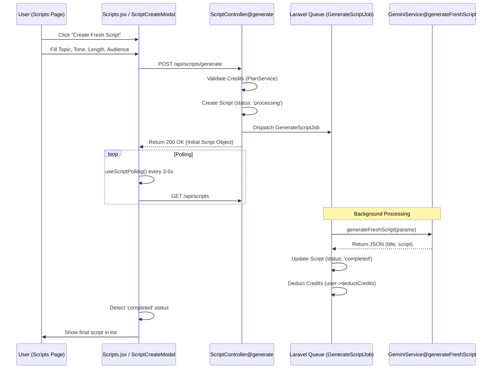

# Fresh Script Generation Workflow

This document outlines the technical flow for generating a completely new AI script from the "Scripts" page.

## Workflow Overview

## Technical Components

### 1. Initiation (Frontend)
- **Component:** `resources/js/Pages/Scripts.jsx`
- **Modal:** `ScriptCreateModal.jsx` (triggered via "Create Fresh Script" button)
- **Action:** `handleGenerate(newScript)`
- **Endpoint:** `POST /api/scripts/generate`

### 2. Request Handling (Backend)
- **Controller:** `app/Http/Controllers/Api/ScriptController.php`
- **Method:** `generate()`
- **Logic:**
  - Validates user credits using `PlanService::creditCost('generate_script')`.
  - Creates a `GeneratedScript` record with `status = 'processing'`.
  - Dispatches `App\Jobs\GenerateScriptJob`.

### 3. Background Processing (Job)
- **Job:** `app/Jobs/GenerateScriptJob.php`
- **Service Called:** `GeminiService@generateFreshScript`
- **Finalization:**
  - Updates the script record with the AI-generated `title` and `script`.
  - Sets `status` to `'completed'`.
  - Deducts credits from the user's balance.

### 4. UI Synchronization
- **Hook:** `resources/js/Hooks/useScriptPolling.js`
- **Integration:** Used in `Scripts.jsx` to periodically refresh the script list as long as any script has a `processing` status.
- **Feedback:** The UI displays a "Generating..." skeleton or loader until the status changes.
