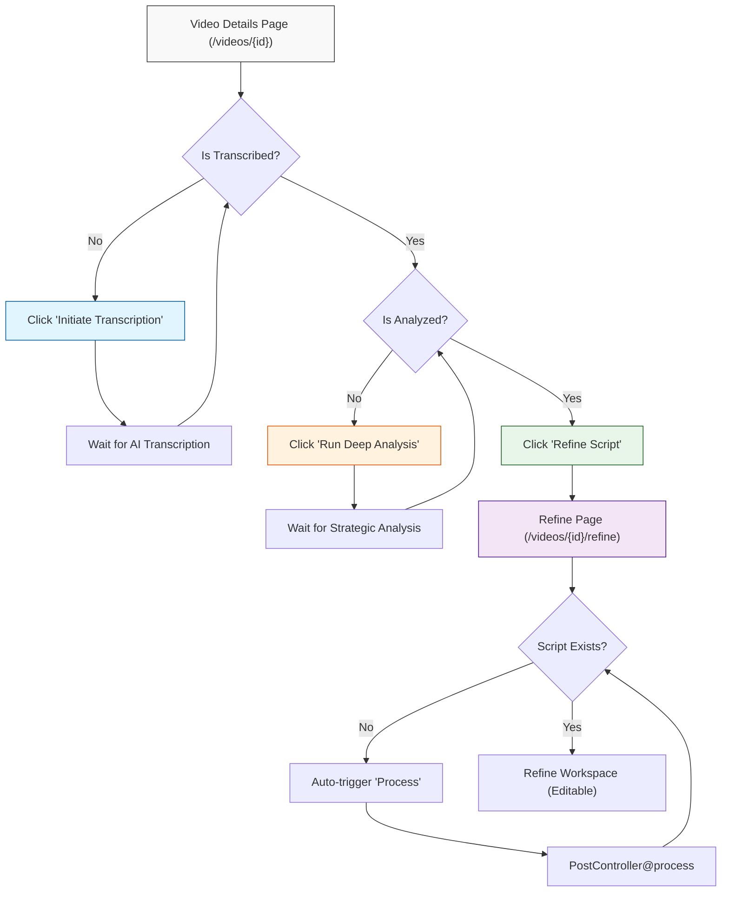

# Script Regeneration Workflow

This document outlines the required steps to regenerate and refine an AI script from a video's detail page.

## Workflow Overview

## Detailed Steps

### 1. Transcription (Required First)
- **Frontend Action:** `handleTranscribe` (Show.jsx)
- **API Endpoint:** `POST /api/posts/{id}/transcribe`
- **Controller Method:** `PostController@transcribe`
- **Core Services:** `ElevenLabsService` & `OpenAIWhisperService`
- **Result:** Extracts the verbatim dialogue from the video.
- **Dependency:** MUST be completed before Deep Analysis can be started.

### 2. Deep Strategic Analysis
- **Frontend Action:** `handleAnalyze` (Show.jsx)
- **API Endpoint:** `POST /api/posts/{id}/analyze`
- **Controller Method:** `PostController@analyze`
- **Core Service:** `ContentProcessingService@analyze`
- **Result:** Uses the transcript to perform a multi-dimensional strategic breakdown (Hook, Content Angle, Psychological Drivers, etc.).
- **Dependency:** Requires the transcript to be present.

### 3. Initial Script Generation
- **Frontend Action:** Triggered on mount in `Refine.jsx` (if no script exists).
- **API Endpoint:** `POST /api/posts/{id}/process`
- **Controller Method:** `PostController@process`
- **Core Service:** `ContentProcessingService@process`
- **Result:** Uses the Strategic Analysis to craft the first version of the script.
- **Deduction:** Credits are typically deducted here for the "Generation" action.

### 4. Refinement & Editing
- **Frontend Page:** `resources/js/Pages/Videos/Refine.jsx`
- **Manual AI Refine:** `POST /api/scripts/{id}/refine` (via `ScriptController@refine`)
- **Result:** Allows the user to iterate on the script with additional constraints (Tone, Language, Duration).
